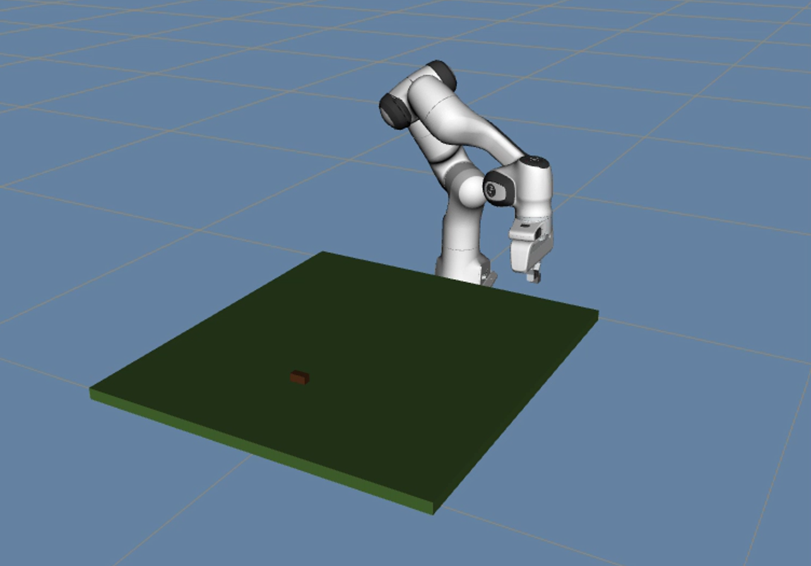
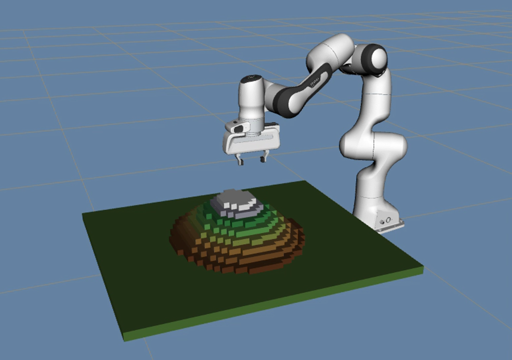
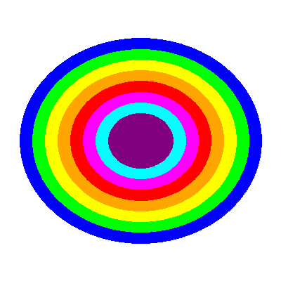
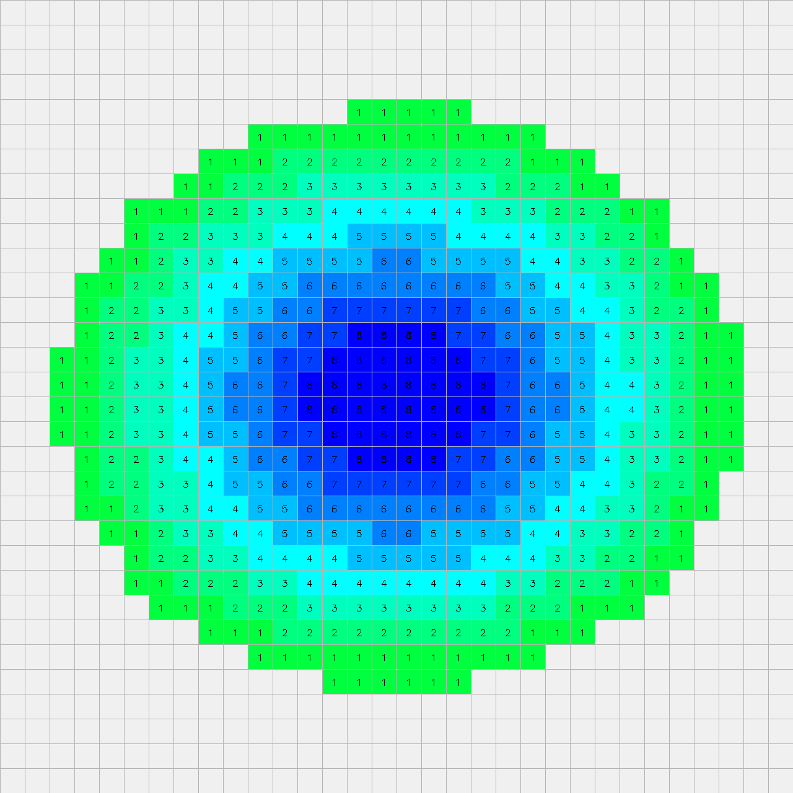

# ROS + MoveIt 3D Terrain Builder

**Automated voxel terrain construction with a Franka Emika Panda arm**

**English** | [简体中文](README.zh-CN.md)


This is the final project of the **Robotics I** course. It converts a contour topographic map into a height matrix and uses a **Franka Emika Panda** 7-DoF arm in **ROS Noetic + MoveIt** to stack 2 cm cubes into a **32 × 32 × 8** voxel terrain, one block at a time.

---

## Gallery

| Building start | Building complete |
|:---:|:---:|
|  |  |

| Input contour map | 32 × 32 height matrix |
|:---:|:---:|
|  |  |

**Demo video:** [demo.mp4](media/demo.mp4) · **Slides:** [Presentation.pptx](docs/Presentation.pptx) · **Report:** [report.pdf](docs/report.pdf)

---

## Overview

The system closes the loop from perception to manipulation:

1. A colored contour map encodes elevation levels as colors.
2. `contour_to_heightmap.py` samples the map onto a grid and produces a height matrix (each value = number of blocks to stack).
3. `terrain_builder.py` plans and executes hundreds of pick-and-place cycles with MoveIt/OMPL.
4. RViz shows the Panda arm, the growing terrain, and the block being carried in real time.

The reference terrain is a 32 × 32 grid with 2 cm cubes, up to 8 layers high (about 0.62 m × 0.62 m × 0.16 m).

## Features

- **Contour-to-heightmap conversion** — 8 color-coded elevation levels, grid-center sampling, and synthetic contour generation (mountain / pyramid / random) when no image is available.
- **Layer-by-layer construction** — every layer is planned separately and built back-to-front so the arm always approaches from the clear side.
- **Collision-safe column management** — each occupied cell is represented by a half-width collision column that is removed before placement and rebuilt at the new height, preventing the arm from knocking over finished stacks.
- **Accurate vertical placement** — a fixed top-down grasp orientation plus absolute-Z Cartesian descent removes accumulated IK error at the final 14 cm.
- **High-frequency block tracking** — the held-block marker follows the gripper at 50 Hz by reading the TF2 tree directly, avoiding `get_current_pose()` latency.
- **Gravity drop animation** — released blocks fall with `g = 9.81 m/s²` for natural-looking placement.
- **Automatic supply management** — a new supply block is spawned after every placement, with progress and ETA logging.

## System architecture

The project follows the three-layer design described in the report:

```
┌──────────────────────────────────────────────────────────────┐
│ Driver Layer      ROS Noetic + MoveIt + RViz                 │
│                   Panda URDF, OMPL (RRT), fake controller    │
└───────────────────────────┬──────────────────────────────────┘
                            │
┌───────────────────────────▼──────────────────────────────────┐
│ Recognition Layer contour_to_heightmap.py                    │
│                   contour image → 32×32 height matrix        │
└───────────────────────────┬──────────────────────────────────┘
                            │ heightmap.npy
┌───────────────────────────▼──────────────────────────────────┐
│ Control Layer     terrain_builder.py                         │
│                   pick-and-place, collision columns, markers │
└──────────────────────────────────────────────────────────────┘
```

## Repository layout

```
ros-moveit-terrain-builder/
├── src/
│   ├── contour_to_heightmap.py   # contour image → height matrix
│   └── terrain_builder.py        # MoveIt pick-and-place pipeline
├── launch/
│   └── terrain_builder_demo.launch
├── rviz/
│   └── terrain_builder.rviz      # terrain-oriented RViz layout
├── docs/
│   ├── report.pdf                # full project report
│   ├── report.tex                # LaTeX source
│   └── Presentation.pptx         # final presentation
├── media/                        # demo video and figures
├── .gitignore
├── README.md                     # English README
└── README.zh-CN.md               # Chinese README
```

## Requirements

- Ubuntu 20.04 with **ROS Noetic**
- **MoveIt 1** (`ros-noetic-moveit`)
- A catkin workspace containing **`panda_moveit_config`** (from `franka_ros`)
- Python 3 with `numpy` and `opencv-python` (`ros-noetic-cv-bridge` / `python3-opencv`)
- `tf2_ros` (`ros-noetic-tf2-ros`)

```bash
sudo apt install ros-noetic-moveit ros-noetic-tf2-ros python3-opencv
```

## Getting started

The launch file expects the two Python scripts and the RViz config to live inside the `panda_moveit_config` package, matching the original course setup.

```bash
# 1. Clone this repository
git clone <repository-url>
cd ros-moveit-terrain-builder

# 2. Copy the runtime files into your catkin workspace
export CATKIN_WS=~/catkin_ws
mkdir -p $CATKIN_WS/src/panda_moveit_config/scripts
cp src/*.py $CATKIN_WS/src/panda_moveit_config/scripts/
cp launch/terrain_builder_demo.launch $CATKIN_WS/src/panda_moveit_config/launch/
cp rviz/terrain_builder.rviz $CATKIN_WS/src/panda_moveit_config/launch/
chmod +x $CATKIN_WS/src/panda_moveit_config/scripts/*.py

# 3. Build and launch
cd $CATKIN_WS
catkin_make
source devel/setup.bash
roslaunch panda_moveit_config terrain_builder_demo.launch
```

> If your `demo.launch` already opens RViz, remove the separate `rviz` node from the launch file to avoid a second window.

## Standalone heightmap generation

`contour_to_heightmap.py` also works without ROS. It can generate a synthetic contour map or read an existing one:

```bash
cd src

# Synthetic mountain: writes contour_map.png, heightmap_visualization.png, heightmap.npy
python3 contour_to_heightmap.py --grid-size 32 --num-levels 8 --shape mountain

# From an existing color-coded contour image
python3 contour_to_heightmap.py --image ../media/contour_map.png --grid-size 32 --num-levels 8
```

The color-to-elevation mapping (BGR, levels 1 → 8) is:

| Level | Color | BGR |
|:---:|:---|:---|
| 1 | Blue | `(255, 0, 0)` |
| 2 | Green | `(0, 255, 0)` |
| 3 | Yellow | `(0, 255, 255)` |
| 4 | Orange | `(0, 165, 255)` |
| 5 | Red | `(0, 0, 255)` |
| 6 | Magenta | `(255, 0, 255)` |
| 7 | Cyan | `(255, 255, 0)` |
| 8 | Purple | `(128, 0, 128)` |

## How it works

**Recognition.** The image is divided into an `N × N` grid; the center pixel of each cell is matched to the nearest contour color with a tolerance. The result is an integer matrix where `heightmap[i, j]` is the number of blocks at row `i`, column `j`.

**Construction.** `build_terrain()` builds one layer at a time. For each cell it picks a cube from the supply area, carries it above the target, releases it, animates the fall, and updates both the visual marker and the collision column. Cells within a layer are sorted from the back row to the front row, so the arm never reaches over unbuilt or freshly built neighbors.

**Grasp and placement.** A fixed orientation (`roll = π`, `pitch = 0`, `yaw = π/4`) keeps the cube aligned with the gripper. The flange target is offset from the desired block center by a calibrated 10.3 cm along the gripper Z-axis. Full-pose IK is used first; if a cell is unreachable, the code falls back to position-only IK.

**Tracking.** During transport, a 50 Hz timer reads the latest `panda_link8` transform from the TF2 buffer and publishes the held-block marker at the gripper center. This is a memory read rather than a service call, so the marker sticks to the gripper with almost no lag.

**Collision handling.** Every occupied grid cell has a collision column with 50% of the block width. It is removed before placing the next block and rebuilt afterwards, which gives the planner clearance between visually touching cubes while keeping the finished terrain stable.

## Key parameters

| Parameter | Value | Description |
|:---|:---|:---|
| `grid_size` | 32 | Terrain grid is 32 × 32 |
| `num_levels` | 8 | Maximum stack height (layers) |
| `block_size` | 0.02 m | Cube side length |
| `grid_spacing` | 0.02 m | Center-to-center spacing (blocks touch) |
| `approach_height` | 0.10 m | Vertical clearance above a placement |
| `table_z` | 0.05 m | Table surface height |
| `_z_offset` | 0.103 m | `panda_link8` → gripper center |
| Supply position | (0.30, 0.35) m | Fixed pick-up point |

The default entry point builds a 32 × 32 terrain with 8 levels; change `TerrainBuilder(grid_size=..., num_levels=...)` in `main()` or call `load_heightmap("heightmap.npy")` to use a precomputed matrix.

## Results

- Recognizes color-coded contour maps and produces a 32 × 32 height matrix.
- Builds a 32 × 32 × 8 voxel terrain in the Panda simulation.
- Reported result: hundreds of pick-and-place cycles without planning errors.
- Terrain is visualized block by block with an elevation color gradient (earth → grass → rock → snow).

## Team

This project was completed by a four-person student team. Roles covered software development, simulation and system integration, report writing, presentation, and demo recording.

## Documentation

- [Project report (PDF)](docs/report.pdf)
- [LaTeX source](docs/report.tex) — compile with `xelatex report.tex` (run twice for the table of contents)
- [Presentation](docs/Presentation.pptx)

## License

This repository contains coursework. Please contact the authors before reusing the code or figures.
