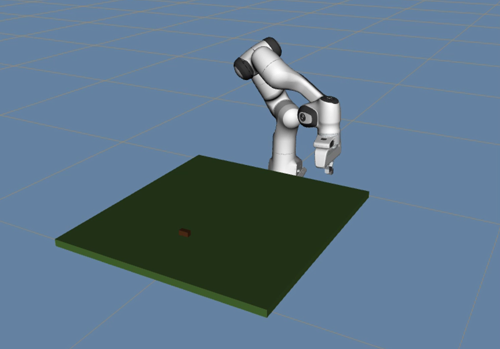
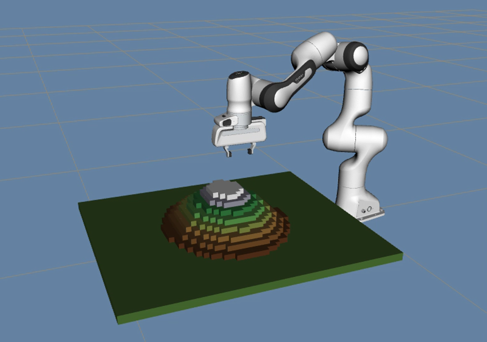
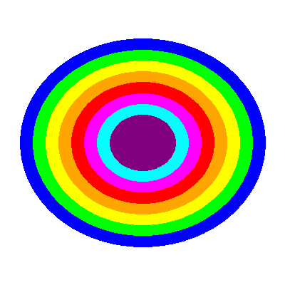
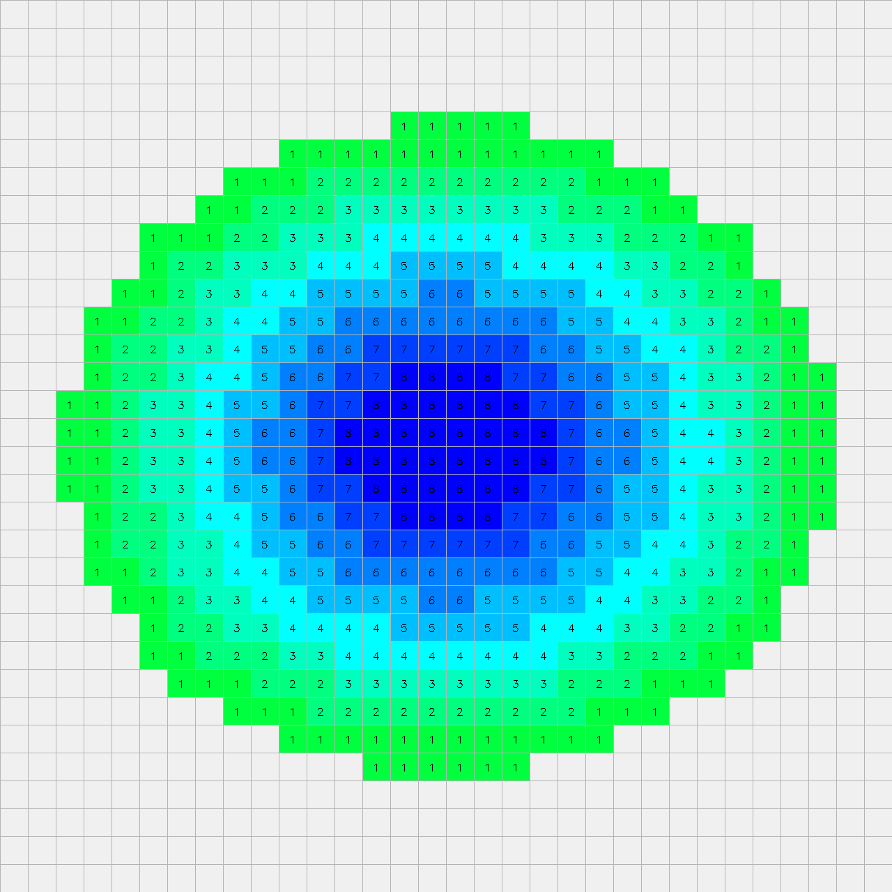

# ROS + MoveIt 三维地形搭建系统

**基于 Franka Emika Panda 机械臂的自动化体素地形搭建**

[English](README.md) | **简体中文**


本项目为《机器人学 I》课程大作业：将等高线地形图转换为高度矩阵，并驱动 **Franka Emika Panda** 七自由度机械臂在 **ROS Noetic + MoveIt** 中逐块搭建 **32 × 32 × 8** 的体素地形。

---

## 效果展示

| 搭建开始 | 搭建完成 |
|:---:|:---:|
|  |  |

| 输入等高线图 | 32 × 32 高度矩阵 |
|:---:|:---:|
|  |  |

**演示视频：** [demo.mp4](media/demo.mp4) · **答辩 PPT：** [Presentation.pptx](docs/Presentation.pptx) · **报告：** [report.pdf](docs/report.pdf)

---

## 项目简介

本项目实现了一套从感知到操作的完整自动化流程：

1. 用不同颜色表示不同高程的等高线地形图作为输入；
2. `contour_to_heightmap.py` 对图像进行网格采样，生成高度矩阵（每个元素表示该位置需要堆叠的方块数）；
3. `terrain_builder.py` 通过 MoveIt/OMPL 完成数百次拾取—放置循环；
4. RViz 实时显示 Panda 机械臂、逐渐生长的地形以及正在搬运的方块。

参考地形为 32 × 32 网格，方块边长 2 cm，最高 8 层（约 0.62 m × 0.62 m × 0.16 m）。

## 主要功能

- **等高线转高度矩阵** —— 8 级颜色编码高程、网格中心采样；没有现成图片时也可生成 mountain / pyramid / random 三种合成等高线图。
- **逐层搭建** —— 每一层单独规划，并按从后到前的顺序施工，机械臂始终从无遮挡的一侧接近目标。
- **碰撞柱管理** —— 每个已占用网格用一个半宽碰撞柱表示；放置前临时移除，放置后按新高度重建，避免机械臂碰倒已完成的方块。
- **精确垂直放置** —— 固定自上而下的抓取姿态，并在最后 14 cm 使用绝对 Z 坐标的笛卡尔直线下降，消除 IK 累积误差。
- **高频方块跟踪** —— 搬运过程中以 50 Hz 直接读取 TF2 坐标树更新方块标记，避免 `get_current_pose()` 的延迟。
- **重力下落动画** —— 松开后方块按 `g = 9.81 m/s²` 下落，视觉效果更自然。
- **自动补料** —— 每次放置后自动在供料区生成新方块，并输出进度与预计剩余时间。

## 系统架构

项目采用报告中的三层架构：

```
┌──────────────────────────────────────────────────────────────┐
│ 驱动层        ROS Noetic + MoveIt + RViz                     │
│               Panda URDF、OMPL（RRT）、fake controller        │
└───────────────────────────┬──────────────────────────────────┘
                            │
┌───────────────────────────▼──────────────────────────────────┐
│ 识别层        contour_to_heightmap.py                        │
│               等高线图 → 32×32 高度矩阵                       │
└───────────────────────────┬──────────────────────────────────┘
                            │ heightmap.npy
┌───────────────────────────▼──────────────────────────────────┐
│ 控制层        terrain_builder.py                             │
│               拾取放置、碰撞柱、可视化标记                     │
└──────────────────────────────────────────────────────────────┘
```

## 仓库结构

```
ros-moveit-terrain-builder/
├── src/
│   ├── contour_to_heightmap.py   # 等高线图 → 高度矩阵
│   └── terrain_builder.py        # MoveIt 拾取—放置主流程
├── launch/
│   └── terrain_builder_demo.launch
├── rviz/
│   └── terrain_builder.rviz      # 面向地形搭建的 RViz 配置
├── docs/
│   ├── report.pdf                # 完整项目报告
│   ├── report.tex                # LaTeX 源码
│   └── Presentation.pptx         # 答辩 PPT
├── media/                        # 演示视频与图片
├── .gitignore
├── README.md                     # 英文 README
└── README.zh-CN.md               # 中文 README
```

## 环境要求

- Ubuntu 20.04 + **ROS Noetic**
- **MoveIt 1**（`ros-noetic-moveit`）
- 包含 **`panda_moveit_config`** 的 catkin 工作空间（来自 `franka_ros`）
- Python 3、`numpy`、`opencv-python`（`ros-noetic-cv-bridge` / `python3-opencv`）
- `tf2_ros`（`ros-noetic-tf2-ros`）

```bash
sudo apt install ros-noetic-moveit ros-noetic-tf2-ros python3-opencv
```

## 快速开始

与原课程环境一致，launch 文件默认两个 Python 脚本和 RViz 配置都位于 `panda_moveit_config` 包内。

```bash
# 1. 克隆仓库
git clone <repository-url>
cd ros-moveit-terrain-builder

# 2. 复制运行文件到 catkin 工作空间
export CATKIN_WS=~/catkin_ws
mkdir -p $CATKIN_WS/src/panda_moveit_config/scripts
cp src/*.py $CATKIN_WS/src/panda_moveit_config/scripts/
cp launch/terrain_builder_demo.launch $CATKIN_WS/src/panda_moveit_config/launch/
cp rviz/terrain_builder.rviz $CATKIN_WS/src/panda_moveit_config/launch/
chmod +x $CATKIN_WS/src/panda_moveit_config/scripts/*.py

# 3. 编译并运行
cd $CATKIN_WS
catkin_make
source devel/setup.bash
roslaunch panda_moveit_config terrain_builder_demo.launch
```

> 如果你的 `demo.launch` 已经会打开 RViz，请删除 launch 文件中单独的 `rviz` 节点，避免弹出两个窗口。

## 单独生成高度矩阵

`contour_to_heightmap.py` 不依赖 ROS，可独立运行，既支持生成合成等高线图，也支持读取已有图片：

```bash
cd src

# 合成山地：输出 contour_map.png、heightmap_visualization.png、heightmap.npy
python3 contour_to_heightmap.py --grid-size 32 --num-levels 8 --shape mountain

# 读取已有的颜色编码等高线图
python3 contour_to_heightmap.py --image ../media/contour_map.png --grid-size 32 --num-levels 8
```

颜色与高程的对应关系（BGR，1 → 8 级）如下：

| 高程 | 颜色 | BGR |
|:---:|:---|:---|
| 1 | 蓝 | `(255, 0, 0)` |
| 2 | 绿 | `(0, 255, 0)` |
| 3 | 黄 | `(0, 255, 255)` |
| 4 | 橙 | `(0, 165, 255)` |
| 5 | 红 | `(0, 0, 255)` |
| 6 | 品红 | `(255, 0, 255)` |
| 7 | 青 | `(255, 255, 0)` |
| 8 | 紫 | `(128, 0, 128)` |

## 实现原理

**识别层。** 将图像划分为 `N × N` 网格，取每个网格中心像素，与 8 种等高线颜色按容差匹配，得到整数矩阵；`heightmap[i, j]` 即第 `i` 行、第 `j` 列需要堆叠的方块数。

**搭建流程。** `build_terrain()` 按层施工。对每个待放置网格，先从供料区抓取方块，搬到目标上方后松开，播放下落动画，并同步更新可视化标记和碰撞柱。同一层内按行号从大到小（从后到前）排序，机械臂不会越过尚未搭建或刚刚搭好的方块。

**抓取与放置。** 采用固定抓取姿态（`roll = π`、`pitch = 0`、`yaw = π/4`），使方块与夹爪保持对齐；法兰目标位置由目标方块中心沿夹爪 Z 轴反向偏移 10.3 cm 得到。优先使用全位姿 IK，个别不可达网格自动退化为仅位置 IK。

**方块跟踪。** 搬运时以 50 Hz 从 TF2 缓冲区读取 `panda_link8` 的最新变换，并据此发布手持方块标记。由于是内存读取而非服务调用，标记几乎无延迟地“吸附”在夹爪上。

**碰撞处理。** 每个已占用网格对应一个宽度为方块 50% 的碰撞柱，放置下一个方块前临时移除，放置完成后按新高度重建。这样既给规划器留出通过间隙，又保证已建地形不会被动到。

## 关键参数

| 参数 | 取值 | 说明 |
|:---|:---|:---|
| `grid_size` | 32 | 地形网格为 32 × 32 |
| `num_levels` | 8 | 最大堆叠层数 |
| `block_size` | 0.02 m | 方块边长 |
| `grid_spacing` | 0.02 m | 网格中心间距（方块紧贴） |
| `approach_height` | 0.10 m | 放置前垂直安全高度 |
| `table_z` | 0.05 m | 桌面高度 |
| `_z_offset` | 0.103 m | `panda_link8` 到夹爪中心的偏移 |
| 供料位置 | (0.30, 0.35) m | 固定取料点 |

默认入口会搭建 32 × 32、8 层的地形；可在 `main()` 中修改 `TerrainBuilder(grid_size=..., num_levels=...)`，或调用 `load_heightmap("heightmap.npy")` 使用预先计算好的矩阵。

## 实验结果

- 能够识别颜色编码的等高线地形图，并生成 32 × 32 高度矩阵。
- 在 Panda 仿真环境中完成 32 × 32 × 8 体素地形搭建。
- 报告结果：数百次拾取—放置循环未出现规划错误。
- 地形按高程渐变着色（泥土 → 草地 → 岩石 → 积雪），逐块可视化生长。

## 团队

本项目由四人学生团队完成，分工包括软件开发、仿真与系统集成、报告撰写、答辩展示和演示录制。

## 文档

- [项目报告（PDF）](docs/report.pdf)
- [LaTeX 源码](docs/report.tex) —— 使用 `xelatex report.tex` 编译（运行两次以生成目录）
- [答辩 PPT](docs/Presentation.pptx)

## 许可说明

本仓库为课程作业，代码与图片如需复用，请先联系作者。
